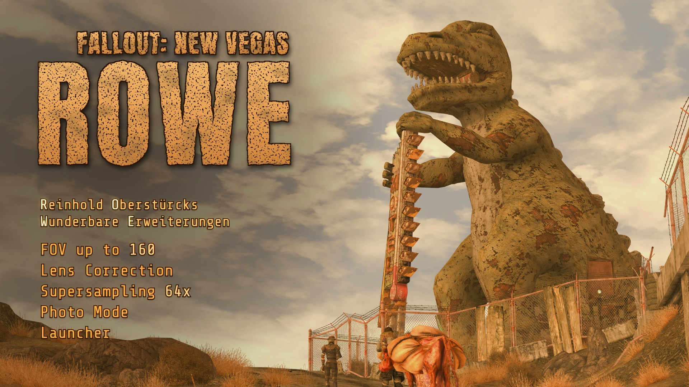

# ROWE for Fallout New Vegas

*Reinhold Oberstürcks wunderbare Erweiterungen* (formerly fnvfov)

A mod for **Fallout: New Vegas** (PC) in the style of
[ROWE for Gears of War (2007)](https://github.com/kerosinkleber/rowe-gears-of-war-2007):

- **FOV slider** (60–160). Aiming keeps its vanilla magnification; scopes are left alone. The
  weapon keeps its size.
- **Lens correction** after [flex-fov](https://github.com/shaunlebron/flex-fov): very wide FOVs
  without stretched edges (Panini or stereographic projection), in gameplay, the Pip-Boy and
  the pause menu.
- **Pip-Boy FOV**: how big the Pip-Boy appears, separately from the world FOV.
- **Supersampling** up to 64× (8× width and height; renders at a higher resolution and averages it down), in
  windowed, borderless **and** fullscreen mode. The HUD and menus keep their size. The factor (and the
  pixel size below) changes **while you play**: the screen goes black for a moment, and the settings menu
  asks whether to keep the new resolution (it goes back by itself after 15 seconds).
- **Pixelated look**: the game renders at a lower resolution (the window's divided by 2–8) and
  each of its pixels is shown as a hard, square block of 2×2 to 8×8 window pixels instead of being
  blurred: the whole image, or only the world with the HUD and menus kept sharp at the window's
  resolution.
- **Mouse trap**: the game normally captures the mouse everywhere, menus included. Mode
  "gameplay" keeps it captured in gameplay and **frees it in menus** (the game's menu cursor then
  follows the Windows cursor, which can leave the window); "always" keeps it inside the window
  everywhere.
- **Intro skip**: clears the intro video settings in memory.
- **Autosave** every so many minutes of play (you choose the interval), into a few rotating saves.
- **Photo mode**: fly anywhere, invisible (no shadow, weapon holstered) and undetectable, the world loading as you go; Space / Ctrl fly up and down, Shift flies faster, the mouse wheel zooms. Small windows show the view (FOV, zoom, lens) and the keys; they are never in your screenshots. **Photo mode is experimental: when you are done, load a save made before you used it instead of playing on.**
- **Fullscreen at any size**: fullscreen at a size the monitor has no display mode for (1400x1400,
  say) would stop the game with "failed to initialize renderer"; the mod runs it as a borderless
  window of that size instead, centred on a black background.
- A **launcher** with your saves and the game's graphics settings, and an in-game **settings menu** (F8) and **screenshots** (F12, at the supersampled resolution, JPEG or PNG, to a folder you choose).

It is an xNVSE plugin (`Data\NVSE\Plugins\rowe.dll`). No game files are modified.

## Requirements

- `FalloutNV.exe` **1.4.0.525** (Steam, GOG, or Epic with its patcher). Every code patch checks the
  bytes it replaces first; on another build that feature switches itself off.
- [xNVSE](https://github.com/xNVSE/NVSE/releases) 6.x.

## Installing

**Mod Organizer 2 / Vortex:** install `ROWE-<date>.zip` from the
[releases](https://github.com/kerosinkleber/rowe-fallout-new-vegas/releases). Its installer offers the
**MCM page** (pre-ticked when The Mod Configuration Menu is active).

To start the game with the **ROWE launcher** from Mod Organizer 2, add it once:

1. Choose `<Edit...>` in the list next to the Run button (the executables), click `+` and
   **Add from file**, pick this mod's `NVSE\Plugins\rowe_launcher.exe` (in MO2's mods folder, for
   example `mods\ROWE for Fallout New Vegas\NVSE\Plugins\rowe_launcher.exe`), name it
   "ROWE Launcher" and click OK.
2. Choose "ROWE Launcher" in that list and click **Run**; MO2 keeps it selected.
3. Desktop shortcut (optional): the **Shortcut** button next to Run, then **Desktop**. It starts the
   launcher through MO2 (while the game runs MO2 shows a small "waiting on an application" window,
   as for any MO2 shortcut: leave it open).

**By hand** (`ROWE-<date>-manual.zip`):

1. Install xNVSE into the game folder.
2. Copy `rowe.dll` (and `rowe_launcher.exe`, optional) to `<game>\Data\NVSE\Plugins\` (or install it as a mod with a mod manager).
3. Start the game through `nvse_loader.exe` (or a 4GB-patched `FalloutNV.exe`).

To uninstall, delete `rowe.dll` and `rowe_launcher.exe`, plus `rowe.ini` and `rowe.log` if they exist.

### Upgrading from fnvfov

ROWE was called fnvfov before. Remove the old files (`fnvfov.dll`, `fnvfov_launcher.exe`,
`fnvfov - MCM.esp`): with both DLLs installed both would load. The settings come along by
themselves: when `rowe.ini` does not exist yet, the plugin (or the launcher) writes it from
`fnvfov.ini`, which is left as it was. In Mod Organizer 2, point the launcher's executable at
`rowe_launcher.exe` and tick `ROWE - MCM.esp` instead of the old plugin.

### ReShade

ReShade works with the mod as it is. With supersampling, its effects are only included in the mod's
full-size screenshots (F12) when ReShade is the **"ReShade with full add-on support"** build from
reshade.me (same installer, same presets): the mod then has ReShade apply its effects to the
supersampled frame (`reshadefirst`, below). With the standard build the effects still show on
screen, but the mod's full-size screenshots are taken without them.

### Mod Organizer 2 / Vortex

`tools\package.ps1` (after `build.bat`) writes `dist\ROWE-<date>.zip` with `NVSE\Plugins\rowe.dll`,
`rowe_launcher.exe` and a short readme, laid out relative to `Data`. In MO2: *Install a new mod
from an archive*, pick the zip, enable the mod, and start the game with MO2's NVSE executable (add
`nvse_loader.exe` under Executables if it is not listed). The plugin's `rowe.ini` and
`rowe.log` then appear in Overwrite; move `rowe.ini` into the mod to keep your settings with it.
To use the [launcher](#launcher), also add the mod's `NVSE\Plugins\rowe_launcher.exe` under
Executables and start it from MO2.

### Launcher

`rowe_launcher.exe` (next to the DLL) replaces the vanilla launcher, in the look of the game's
HUD (the game's UI font from its archives, the HUD colour from its INI files):

- **Saves:** every save with its picture, player, level, location, play time and date, newest first,
  plus *Main menu*. **PLAY** (or a double click) starts the game through xNVSE and loads that save as
  soon as the main menu is up. The launcher writes the plugin's start file
  (`Data\NVSE\Plugins\rowe_restart.txt`, the same one the menu's restart uses) and starts the game
  the way the restart does (a 4GB-patched `FalloutNV.exe` that loads xNVSE itself, else
  `nvse_loader.exe`), then closes.
- **Settings:** everything the vanilla launcher sets, with its keys and values (read from
  `FalloutNVLauncher.exe` 1.2.14): adapter, resolution, windowed, vertical sync, antialiasing,
  anisotropic filtering, screen effects; the Detail, Water, Shadows, View distance and Distant LOD
  pages; the Low / Medium / High / Ultra presets (the game's `Low.ini` ... `VeryHigh.ini`, merged key
  by key). Plus the mod's **supersampling** (with the size it renders at). **Custom size** takes any
  width and height: *use* sets it, *save preset* keeps it at the top of the resolution list (*delete
  preset* removes it; stored in `rowe.ini`, `[launcher] resolutions=`). A size that is not one of the
  monitor's display modes is marked when full screen is on (the mod then runs it borderless, centred).
  Changes are saved at once:
  to `FalloutPrefs.ini`, or to `FalloutCustom.ini` where that file sets the key (marked `*`, since that
  is the value the game ends up with). Before its first change the launcher keeps a copy of each as
  `<name>.rowe-launcher.bak`.
- **Mod:** autosave (on/off, minutes, slots); photo mode (shortcut, fast speed, hide the HUD, freeze people); the settings menu key (default F8) and the screenshot key (default F12): click, then
  press the key (Esc cancels; the two must differ); the screenshot folder: typed (Enter applies),
  **browse** (Windows' folder picker) or **open** in Explorer, with the folder it resolves to.
  Saved to `rowe.ini` (`menukey`, `screenshotkey`, `screenshotdir`), the same values the
  in-game menu sets.
- **Background:** the game's loading screens (the pictures of its loading screen records,
  `textures\interface\loading\loading_<kind>NN.dds`, loose or from the archives, so loading screen
  replacers show too) as a slideshow behind the launcher: dimmed, in random order, crossfading
  with a slow zoom. *Mod*, *Launcher background* turns it off (`[launcher] slideshow=0`) and
  *Background brightness* sets how much of it shows through (`[launcher] slidebrightness=`, 10-100,
  default 50).
- **Font size:** the text grows and shrinks with the window. *Mod*, *Font size* sets its size for a
  1350 x 800 window, 14-48 px (`[launcher] textsize=`, default 28; the slider also shows the size
  now); it applies when the slider is let go.
- **Text glow:** text on the background has a dark glow around it. *Mod*, *Text glow* sets its
  darkness (0-200%, 0 = none; `[launcher] glowstrength=`, default 100) and *Glow size* its reach
  (25-300%; `[launcher] glowsize=`, default 100).
- **Mod Organizer 2:** add it under *Executables* (binary: the mod's
  `NVSE\Plugins\rowe_launcher.exe`) and start it from MO2. It then reads the game folder from MO2's
  `ModOrganizer.ini`, sees the profile's INI files and saves through MO2's virtual file system, and the
  game it starts runs inside MO2. Started outside MO2 it shows the plain install's saves (and says so
  when the INI files point at MO2's save folder).

### The Mod Configuration Menu (optional)

With [The Mod Configuration Menu](https://www.nexusmods.com/newvegas/mods/42507) (MCM) installed,
enable `ROWE - MCM.esp` (in the archive, next to `NVSE`) and ROWE gets a page in the pause
menu's *Mod Configuration*: field of view, lens, fisheye fill / full circle, scope overlay, zoom
and Pip-Boy FOV (each with "use the game's"), supersampling (off, 2x, 4x, 9x ... 64x: MCM lists
hold ten entries; other factors stay in the F8 menu), mouse trap, intro videos, autosave, photo mode (fast speed, HUD,
freeze people; the shortcut is set in the F8 menu or the launcher), and the screenshot
size, format and quality, with a help text for each. Changes are saved to `rowe.ini` like the F8
menu's. The plugin contains one item (the entry MCM lists) and no scripts; without MCM it does
nothing, and ROWE works the same without it. It uses one load order slot.

### Starting straight into a save

`tools\continue.ps1` starts the game through xNVSE and loads your newest save (autosave and
quicksave included) as soon as the main menu exists, without clicking through it. It writes the
plugin's command file (`rowe_cmd.txt`: `wait 300`, then the console command
`load "<save>"`) and starts `nvse_loader.exe`. `-Save "<name>"` loads a specific save (the file
name without `.fos`); `-Game` sets the game folder (default: the install the registry names). It does
nothing if the game is already running. A desktop shortcut for it:
target `powershell.exe -NoProfile -ExecutionPolicy Bypass -WindowStyle Hidden -File "<repo>\tools\continue.ps1"`.

## Using it

| Key | In game |
|---|---|
| F8 | Open or close the settings menu (`menukey`) |
| F12 | Screenshot (key, folder, size and format: in the menu, or the `screenshot...` settings below). When it is written, "<file> was saved to <folder>" shows at the top of the screen for a few seconds; that notice is never in a screenshot |
| F10 | Photo mode on / off (`photokey`, also with Ctrl / Alt). In photo mode: the movement keys fly you where you look, Space up, Ctrl down; hold Shift to fly `photofast` times faster; the mouse wheel zooms (5 degrees to the FOV maximum, back when photo mode ends). A window at the top left shows the FOV, the zoomed FOV and the lens; one at the bottom shows the keys and the warning below. Neither is in screenshots. Esc opens the pause menu (it works as usual, Settings, Help and the rest too) and photo mode waits: it carries on where you were when you are back in the game. The Pip-Boy, your weapon (drawing, attacking, aiming, VATS, the hotkeys) and saving are off while photo mode is on. Photo mode is experimental: when you are done, load a save made before you used it instead of playing on |
| F7 | Next lens: off, Panini, stereographic, fisheye (`lenskey`); the lens shows at the top of the screen for a few seconds |
| F11 | Show or hide the stats window (`statskey`) |

The settings menu (F8) is used with the mouse (sliders, lists, checkboxes; hover for an
explanation) or the keyboard (arrows, Enter, Tab). It has four tabs: **View** (FOV, lens, scope
overlay, zoom FOV, Pip-Boy FOV with a **take out / put away** button to see the Pip-Boy while
setting it; "game" uses the game's own value; the lens key), **Image** (supersampling, pixelated look and
whole image or world only, ReShade first), **Screenshots** (key: click and press the new key; folder; size; format; JPEG
quality; **browse** picks the folder in a list, like ReShade's path picker), **Photo** (the experimental warning, start / end, the shortcut,
the fast speed, hide the HUD, freeze people) and **Other** (mouse
trap, intro videos, **autosave** (on/off, the minutes typed in, the number of slots), menu key, **stats**: a small window with the active lens and the supersampling
sizes, also with the menu closed, and its key). A new supersampling factor or pixel size applies at once; below it the
menu asks "Keep this resolution?" with **keep** and **go back**, and goes back by itself after 15 seconds (closing the
menu keeps it). Below the tabs, **restart game** applies the settings that only take effect
at start (intro videos; supersampling and the pixel size where they cannot change while the game runs; the row says
when one is waiting): the game is saved as
`rowe_restart`, started again the way it was started (`nvse_loader.exe`, or a 4GB-patched
`FalloutNV.exe` that loads xNVSE itself; under Mod Organizer 2 it stays in MO2's virtual file
system) and that save is loaded. While the menu is open the game gets no mouse or
keyboard input and the mouse is free; changes apply at once and are saved. It is drawn in the
style of the game's HUD (the HP / AP brackets): the game's UI font and HUD colour, thick glowing
frame lines with chamfered joints, sliders as segmented meters, choices boxed like Pip-Boy list
entries. F7, F8, F10, F11 and F12 are unbound
in the game's default controls (F5 is QuickSave there, F9 QuickLoad). Settings are saved to `rowe.ini` next to
the DLL:

| Key | Values | Default |
|---|---|---|
| `fov` | `0` = game default, otherwise 60–160, in the game's own unit (horizontal FOV at 4:3, like `fDefaultWorldFOV`; the game's default is 75, which is 91° at 16:9) | `0` |
| `zoomfov` | `0` = game default (`fIronSightsZoomDefault`, 50, shown as about 96 with FOV 130), otherwise 10–160 in the same unit as `fov`: where the zoom ends when you aim with the weapon holstered | `0` |
| `pipboyfov` | `0` = game default (47), otherwise 20–90 in the same unit. Lower makes the Pip-Boy bigger. | `0` |
| `lens` | `0` off, `2` Panini, `3` stereographic, `4` fisheye (equidistant: angles spread evenly from the centre; up to 160° across the screen, the corners beyond 90° to the side stay black like a fisheye lens' vignette). `1` (the former auto lens) reads as Panini. Only active when `fov` is set. | `2` |
| `supersample` | Pixel-count multiplier 1–64 (`4` = twice the width and height, `16` = four times, `64` = eight times). Applies at once (see "Changing the resolution while playing" below). The game's own antialiasing is reduced so that factor × samples stays ≤ 64 (16× gets 4× MSAA, 25× 2×, 36× and up none, where it adds nothing visible but takes gigabytes of video memory, most of all in VATS); FalloutPrefs.ini keeps your value. | `1` |
| `pixelsize` | Pixelated look: `2`–`8` window pixels per game pixel across and down (`4` at 1920×1080 renders at 480×270). The game really renders at that size (every render target, the depth buffer, HDR and bloom), and each pixel is shown as a hard square block (nearest neighbour), not blurred. If the window is not a multiple of the size, the game renders a few pixels more and the overhang (less than one game pixel at each edge) is cut off, so all blocks stay square and equal. Replaces `supersample` while it is on. Applies at once. The game's own antialiasing (iMultiSample) still works inside the small image and softens the blocks' edges; set Antialiasing to off in the ROWE launcher (or the game's launcher) for the hardest pixels. `1` = off. | `1` |
| `pixelhud` | Pixelated look: `1` the whole image is rendered at the low resolution, HUD, menus, console and cursor included (F8: "whole image"); `0` the HUD and menus are drawn at the window's resolution over the pixelated world (F8: "world only, HUD sharp"). Applies at once. The Pip-Boy is a 3D object in the world, so its screen is pixelated either way (larger pixel sizes make it hard to read; 2 or 3 keep it readable). | `1` |
| `mousetrap` | `0` the game's own behaviour (mouse captured in gameplay and menus), `1` captured in gameplay, free in menus, `2` captured and kept inside the window everywhere. | `0` |
| `skipintros` | `1` clear the intro video settings (applies at the next start) | `1` |
| `fisheyecircle` | Fisheye only. `0` fill: the picture fills the screen's width and the sides of the rendered circle are cut off; `1` full circle: at the widest FOV (160) everything that is rendered is shown, as a circle fitted to the shorter side (with black around it). A lower FOV, aiming or a scope magnify the picture and its circle together, so the circle grows past the screen's edges and disappears, as the fill's black corners do. At 16:9 the circle fitted to the height shows about 145°. F8: View, Fisheye | `0` |
| `scopelens` | `1` the lens also bends the scope overlay (crosshair and black mask), `0` the overlay is drawn flat over the lensed view (F8: SCOPE OVERLAY LENS / FLAT) | `1` |
| `screenshotdir` | Folder for screenshots, created if missing. `%VARIABLES%` are expanded (e.g. `%USERPROFILE%\Pictures\Fallout`); a relative path starts at the game folder. Empty: next to the DLL (under Mod Organizer 2: in Overwrite). | empty |
| `screenshotkey` | Screenshot key: `F1`–`F24`, `A`–`Z`, `0`–`9`, `Num0`–`Num9`, `Home`, `End`, `Insert`, `Delete`, `PageUp`, `PageDown`, `Pause`, `ScrollLock`, `PrintScreen`, or a virtual key code such as `0x7B`. Avoid the menu key and keys the game uses. | `F12` |
| `menukey` | The key that opens and closes the settings menu, named as `screenshotkey`. Pick one the game does not use. | `F8` |
| `lenskey` | The key that switches to the next lens (off, Panini, stereographic, fisheye), named as `screenshotkey`. | `F7` |
| `statskey` | The key that shows and hides the stats window, named as `screenshotkey`. | `F11` |
| `screenshotsize` | `full`: the size the game renders at (with supersampling, e.g. 11520x6480 at 36x and a 1920x1080 window); `window`: the window's size. | `full` |
| `screenshotformat` | `jpg` or `png`. JPEG at quality 95 is visually lossless at these sizes, about 5x smaller and over 10x faster to write (36x, 1920x1080: 16 MB in 0.3 s against 73 MB in 4.5 s); PNG is lossless, for editing. Either way the game does not wait: the frame is copied on the GPU and written by a background thread. | `jpg` |
| `screenshotquality` | JPEG quality 1–100. | `95` |
| `reshadefirst` | With ReShade's **add-on build** ("ReShade with full add-on support") and supersampling: `1` has ReShade render its effects into the supersampled frame before it is averaged down, so they are in the full-size screenshots (and applied at the higher resolution); ReShade then skips its own pass. `0`: ReShade as usual (on the window-sized frame, missing from the mod's full-size screenshots). The standard ReShade build refuses add-ons; nothing changes then. Effects that read the depth buffer may not find it at the supersampled size. | `1` |
| `stats` | `1` shows a small window with the active lens (mode, the FOV it shows and the FOV rendered for it) and the supersampling sizes, also with the settings menu closed; drag it while the menu is open to move it (`statsx`, `statsy`: its position as fractions of the screen, `-1` = top right) The window is also in the screenshots the screenshot key takes (not the settings menu); at full size its text is the on-screen text magnified, so it looks soft at high supersampling. | `0` |
| `statssize` | The stats window's text size, 50-200 percent of the menu's | `80` |
| `autosave` | `1` saves the game every `autosaveminutes` minutes of play as "ROWE Autosave 1", 2, ... in turn. Only time in gameplay counts (not menus, loading screens or the game in the background); when the time is up during combat or with the player dead it waits until that is over; loading, starting or saving a game (your own saves too) starts the count again. Also on the launcher's Mod tab and the MCM page. | `0` |
| `autosaveminutes` | Minutes of play between autosaves, 1-240. | `20` |
| `autosaveslots` | How many autosaves are kept, 1-10: the oldest is overwritten (`autosavenext` is the next slot). | `3` |
| `photokey` | Photo mode shortcut: a key name as `screenshotkey`, optionally with `Ctrl+` / `Alt+` (e.g. `Alt+P`; in photo mode Shift is the speed key and Ctrl flies down). Photo mode: the player flies with collision off (`tcl`; they move where they look, so the game loads the world around them as when walking), invisible (`SetActorAlpha 0`, and their 3D culled, so they cast no shadow either) with the weapon holstered (drawn again after) and undetectable (`tdetect`), seen from the first person (switched there and back if you were in the third, so the camera turns around the eye; the first-person arms are hidden too), the HUD hidden (`tm`) if `photohud=1`, people and creatures stopped (`tai`) if `photofreeze=1`. It starts only in gameplay. The shortcut again puts the player back where photo mode started (a marker is left there and the player is moved to it with `MoveTo`; the marker is deleted after); The pause menu (Esc) pauses it, and so do the menus opened from it; it carries on where it was when the game is back in gameplay (the HUD photo mode hid is shown and the controls it turned off are given back meanwhile: Attack's left mouse button kept the menu from taking clicks); opening another menu ends it the same way (the Pip-Boy key is off while it is on), and loading a game, the main menu and quitting end it too. The shortcut starts it again at once, also right after it ended (it then carries on from the same start). The first person and the drawn weapon come back once the game is in gameplay again. Everything is put back as it was: each toggle is toggled back only if photo mode toggled it. No game is saved while it is on (the pause menu's Save, Quicksave, autosaves and the console's `save` are refused with a notice; the mod's autosave waits), so no save keeps the invisible player; some of the game's controls are off too: Run, Jump and Sneak (Shift would also switch to walking, Space and Ctrl fly up and down), the Pip-Boy (it would end photo mode), and Attack, Aim, Ready Item, VATS, the hotkeys and Ammo Swap, so the invisible player cannot fight. Shift, Space and Ctrl are also hidden from script mods (`DisableKey`), so a sprint mod on Shift (JAM's) does not sprint and shake the camera while you fly fast. The start marker is placed 10 frames before photo mode starts: placed in the same frame, it crashed a modded game (TTW) in a background thread. All are enabled again after only if they were. A window at the top left shows the FOV, the zoomed FOV and the lens, one at the bottom the keys and the warning; the overlay draws them after the screenshot is copied, so they are never in one. | `F10` |
| `photofast` | Photo mode: how many times faster you fly while Shift is held (1-50), up and down too. The movement settings and `SpeedMult` do not change the flying speed, so the mod scales the movement itself where the game places the flying player each frame (whatever moves them, animation mods included). The game's own step per frame is uneven (at 60 fps 5.4, 5.1 and 3.4 units in turn), which made the view jerk, more so when fast: the mod flies at the steady average of it instead, times the real frame time. | `5` |
| `photohud` | Photo mode: `1` hides the HUD. | `1` |
| `photofreeze` | Photo mode: `1` stops people and creatures. | `0` |
| `showcase` | `1`: the screenshot key takes the showcase series instead of one shot: no lens, Panini, stereographic and fisheye at FOV 75, 90 and 160 (12 shots, window size, the stats window in each), named `ROWE_showcase_<time>_fov<fov>_<lens>`. Your FOV, lens and stats come back after; the key again stops it. Also the "Showcase" checkbox on the menu's Photo tab. | `0` |

Notes:

- Vanilla New Vegas plays no startup videos (its `SIntroSequence` is empty); intro skip matters
  for INI tweaks or mods that add them. The new-game cinematic is not affected.
- Supersampling is demanding: at 64× a 1350×1080 window is rendered at 10800×8640. The width and
  height are limited to 16384 (the graphics card's maximum); the mod then uses the largest factor
  that fits both. Lower the factor if the frame rate drops or the game fails to start (the
  graphics card's memory runs out).
- Changing the resolution while playing: the game resets its graphics device (the screen is black
  for a moment) and builds its buffers again at the new size. If it cannot (not enough video memory,
  or it keeps resetting), the mod goes back to the previous size and says so at the top of the
  screen. The game's antialiasing stays at what it was at start; a higher factor lowers it as at a
  start (16× gets 4× MSAA, 36× none), a lower factor does not raise it again until the next start.
  In a Tale of Two Wastelands list with NVTF's `bModifyDirectXBehavior=1` (the game keeps
  its resources over a reset) any device reset could crash in the graphics driver now and then in
  testing (about one in 15, also without ROWE's supersampling and without changing the size, the same
  as alt-tabbing out of fullscreen there); each change is one reset.
- Pixelated look: the lens (FOV over 90) bends the small image before it is enlarged, so the
  blocks stay square on screen; photo mode works as usual. Screenshots are taken at the window's
  size (blocks and sharp HUD as shown). The interface's mouse positions are in the small image's
  units stretched over the window, which can differ from the blocks by part of one game pixel at
  the edges when the window is not a multiple of the pixel size.
- Windows narrower than 4:3 (5:4, 1:1, portrait): the menus, console and Pip-Boy screen are laid
  out at 4:3 in the middle of the window (the game itself cuts them off there); the HUD uses the
  window's top and bottom edges, and the pause menu's vignette, loading screens and scope overlays
  cover the window (loading screens cropped at the sides). The world fills the whole window. 4:3 and wider is unchanged.
- The lens can show at most about 160° (one rendered view); near the limit the menu shows the
  maximum it reached.
- With DXVK: DXVK reports NVIDIA cards as AMD by default, which makes New Vegas think the GPU
  changed and quit into its launcher (that has nothing to do with this mod). Put
  `d3d9.hideNvidiaGpu = False` in a `dxvk.conf` next to the game's exe.
- Tested together with JohnnyGuitar NVSE 5.28 and DXVK 3.1.1. Not tested yet: ENB, ReShade, NVTF,
  JIP LN, New Vegas Reloaded.

## How it works

The game runs window, input, game loop and rendering on one thread. All addresses are for
`FalloutNV.exe` 1.4.0.525.

| Feature | How |
|---|---|
| D3D9 | The exe looks up `Direct3DCreate9` with `GetProcAddress`; the plugin wraps that lookup, hooks `IDirect3D9::CreateDevice` and then the device's methods (whatever `d3d9.dll` is loaded). The pure-device flag is removed so the mod's passes can save and restore state. |
| FOV | Detours `BSSceneGraph::SetCameraFOV` (0x00C52020). The world call sites get the slider's angle: tan(fov/2) scaled by tan(slider/2)/tan(75/2), fading out below 55° so scopes keep their zoom; viewmodel and over-shoulder sites are left alone. The stored FOV values stay vanilla. |
| Zoom FOV | Aiming with the weapon holstered eases the world FOV from `fDefaultWorldFOV` to `fIronSightsZoomDefault:Combat` (0x0095DE30). With `zoomfov` set and no weapon drawn (`BaseProcess::IsWeaponOut`, as the aiming code asks), the game's progress along that easing is mapped straight to the slider FOV → `zoomfov`, evenly in log tan, so the zoom keeps the game's timing and a constant zoom speed (it does not pass through the remap's fade to the scope range). |
| Pip-Boy FOV | While the Pip-Boy is up (InterfaceManager `pipBoyMode`), the viewmodel FOV's easing from 55 to `fPipboy1stPersonFOV` ends at the chosen value instead. With the lens on, the Pip-Boy is widened for the lens of the stored world frame it is drawn over (the game does not redraw the world while the Pip-Boy is up), so changing the FOV while it is out does not change its size. The menu's take out / put away button runs `TapControl 14` (the Pip-Boy control) on the next main-loop tick. |
| Lens | The world is rendered at the wider FOV the lens needs. At world draw (0x00870E18) the camera frustum gives the FOV this frame was rendered with; at the call to `InterfaceManager::Render` (0x007144D3), after post-processing and before the HUD, a full-screen pass (`lens.hlsl`) resamples the frame into the lens projection. The gun's FOV is widened by the lens' centre scale so it keeps its size. With `scopelens=0`, while scoped the warp runs before the first-person pass instead (at the post-image-space call, 0x008703F1) and that pass keeps the game's FOV, so the scope overlay is drawn flat on top. With the Pip-Boy or the pause menu open the game stops drawing the world and shows a stored copy of the last world frame; those frames are warped with that frame's FOV. While a terminal (ComputersMenu 1057) or its hacking screen (1055) or a casino game (slot machine 1080, blackjack 1081, roulette 1082, Caravan 1083) is open the lens is off: these show a model right in front of the camera (the terminal's screen, the table), made for a flat image. While the Pip-Boy screen is the active menu (fully open, and no other menu such as the pause menu, a message box, the "how many?" box or a tutorial tooltip over it) (menus a plugin keeps visible during gameplay, such as 1085 in Tale of Two Wastelands lists, are noted and do not count) the warp runs after the UI (at Present), so the game's hit-testing matches what is shown; the cursor is cut out of the warped frame (using a copy of the frame from before the UI) and drawn unwarped, at its normal size, where its hit point is shown. Mouse motion is scaled by the lens' local scale at the cursor (render pixels per shown pixel), so the cursor moves at the same speed as in flat menus. While the left button is held on the Pip-Boy (panning the map, dragging a scroll bar) the game gets the mouse's own motion, unscaled and not steered by the free mouse, as without the mod; with the free mouse the Windows cursor is put where the game's cursor is shown when the button is released. With the free mouse the game's cursor is aimed through the same mapping. |
| Launcher | `src/launcher`: a Win32 window with a Direct3D 9 device and Dear ImGui, sharing the menu's HUD drawing (`hudstyle.cpp`) and font loader (`gamefont.cpp`). The game folder: MO2's `ModOrganizer.ini` `gamePath` when the parent process is `ModOrganizer.exe` (portable instance next to it, else the current instance under `%LOCALAPPDATA%`), else above the launcher, the working folder, or the `Installed Path` registry value. Saves: `My Games\FalloutNV\` + `SLocalSavePath` from `Fallout.ini` (MO2 sets `__MO_Saves\` there); the header is `FO3SAVEGAME`, header size, version, then `|`-separated fields (language, picture width and height, save number, player, karma title, level, location, play time; strings as u16 length) followed by the RGB picture. Font: `sFontFile_2` from the INI files, loose or from the BSAs (v104, zlib via a small inflate after puff.c), its first texture's alpha from the DDS (uncompressed with an alpha mask, or DXT1/3/5). |
| MCM page | `mcm.cpp`: MCM lists one item per mod (its form list `MCMMods`, 0xAE6 of `The Mod Configuration Menu.esp`) and identifies the mod by that item's plugin, so `ROWE - MCM.esp` (written by `tools/make_mcm_esp.py`) holds a MISC record (0x800) named as the list shows it. When the pause menu opens, the DLL adds that item to the list (`ListAddForm`, if not there) and gets the ESP's mod index; while the page is the active one (`StartMenu/MCM/_ActiveMod`) it answers MCM's traits as MCM mods' scripts do (`_Reset`: titles, types, values; `_NewValue`; `_ShowList`; `_ShowScale`; `_Default`; the mouse-over help in `*:9/string`). The UI is read and written with xNVSE's `GetUIFloat` / `SetUIFloat` / `SetUIString` through script functions compiled with `NVSEScriptInterface::CompileScript`, one per path and text (string variables as parameters do not compile there), cached. |
| Fullscreen at other sizes | `borderless.cpp`: when the game creates its main window (after the INI reads and any `FalloutCustom.ini`), `bFull Screen` set and the native size not among the primary monitor's display modes (`EnumDisplaySettings`): the setting is cleared so the game takes its windowed path, its `AdjustWindowRect` calls add no frame, and when it places the main window (`SetWindowPos`) the window becomes a borderless popup of the native size, centred, owned by a black `WS_EX_NOACTIVATE` backdrop covering the monitor (the window stays in front of it and gets `WS_EX_APPWINDOW` for its taskbar button). |
| Settings menu | Dear ImGui (`third_party/imgui`, v1.92.9b, MIT) with its Direct3D 9 and Win32 back-ends, drawn into the real back buffer at Present after the resolve (sharp at any supersampling, not bent by the lens). Font: the game's own UI font as loaded (font 2, Monofonto_Large or a UI mod's replacement; `gameui.cpp`: FontManager 0x011F33F8 → FontInfo +0x38 glyph table, +0x0C texturing property → base map texture → renderer data +0x64 the Direct3D texture, whose alpha is copied once and served to ImGui by a font loader that scales each glyph), else Share Tech Mono (`third_party/fonts`, SIL OFL), sized to the window height. Colours follow the game's HUD colour (`uHUDColor:Interface`, the colour of `&hudmain;`), read every frame. The HUD look (`overlay.cpp`, "HUD look") is drawn with ImGui's draw list over plain widgets: the window has no title bar or border but an L-shaped bracket (left line into the baseline, ending in a chamfered rise), each tab's table a baseline with the column divider dropping from it at a 45° chamfer, sliders are transparent `SliderInt`s with vertical segments and the value drawn over them, lines are a translucent wide stroke under the solid one (thickness font size / 8). Input: the game's mouse messages go to the render window (the device's focus window, a child of the main window), which the menu subclasses; while it is open the DirectInput mouse is set non-exclusive (as for the free mouse) and the game's DirectInput mouse and keyboard read nothing; ImGui draws the cursor. |
| ReShade | When ReShade (d3d9.dll) with add-on support is loaded, the mod registers as a ReShade add-on (headers in `third_party/reshade`, v6.6.2) and keeps the effect runtime from its `init_effect_runtime` event; at Present, before the resolve, `effect_runtime::render_effects` renders the effects into the virtual back buffer (device state saved and restored around it), which also stops ReShade's own pass for that frame. |
| Device reset | Before `Reset` (after a lost device: lock screen, display change, driver or overlay events) everything is unbound, and the occlusion queries the game keeps in its query wrapper (0x00C4ECF0), which it does not release itself, are released and created again after the reset; otherwise the reset fails and the game crashes. The mod tracks every default-pool resource, state block and query it sees created and logs the ones still alive at a reset, by creating module. `devicelost` in the command file simulates a lost device. |
| Supersampling | The game's `iSize W/H` reads (`GetPrivateProfileIntA`) return the larger size, so the engine renders everything at it; the window creation and sizing calls get the native size back; `CreateDevice`/`Reset` get a native back buffer; the mod binds a large render target in its place and averages it down in linear light at Present (`downscale.hlsl`; for integer scales with sRGB-decoding bilinear reads, a quarter of the reads). VATS's own image-space textures (a full-size R32F depth pass and quarter-size A8R8G8B8 and A16B16G16R16F blur targets, also used by other effects such as the pause menu's background blur) are created at twice / a quarter of the window size instead, with the game's viewport scaled to them, and the blur shaders' sample steps (given in texels of the requested size) rewritten to texels of the real size, so blur and bloom keep the unmodded game's radius on screen. Writes of `iSize` to the prefs file keep the native size. If another plugin applies `FalloutCustom.ini` to the game's settings after those reads (MO2 lists often do), the mod reads that file's `iSize` where the game reads `FalloutPrefs.ini`'s (the game lists the display modes before the plugin applies it, and the extra mode must match), and the overridden `iSize` is taken as the native size before the first window is created, and `iMultiSample` gets the same cap; if the game still ends up at a size the mod did not plan for, supersampling is off for that start (F8: OFF: SIZE OVERRIDDEN). In fullscreen (where the game uses `CreateDeviceEx`) the display mode is the native one, and the larger size is listed as an extra display mode so the game's mode check accepts it. |
| Changing the resolution while playing | A new factor or pixel size (from the menu, the MCM, `rowe.ini` reloaded, or the test commands) makes the next Present report a lost device, as after a lock screen; the game releases its device resources and calls `Reset` with its own present parameters (a copy it keeps), and at that `Reset` they get the new virtual size, which the game keeps for later resets. After it the mod creates the large render target at the new size, and the game builds its screen-sized targets again, most from the new back buffer size. What it does not rebuild is fixed up: Gamebryo creates its render textures again at their buffer's size (the start's screen size, or a fraction for bloom and luminance), so before that (0x00E8FF60) the buffer (NiRenderedTexture +0x30, width +8, height +0xC) gets the same fraction of the new size; its depth surfaces likewise (multisampled ones the new size, the back buffer's own only grows, as D3D9 needs depth at least as large as the target); the game's screen size globals (0x0118947C/80, read by the interface, e.g. the menus' scissor rectangles, and 0x011F9430/4, read by its render target pool) and size fields follow; the render textures are only resized as Gamebryo recreates them at the reset (until the next Present), not when the engine creates new ones later. Multisampled targets at the new size get the antialiasing cap of the new factor at creation. At factor 1 the large render target is the window's size, so this works from a start without supersampling (`[dev] alwaysvirtual=0` turns that off). The menu's keep / go back is a countdown that asks for the previous size again; the game resetting three times within 10 s of a change, or the large target failing to be created, does the same at once. |
| Pixelated look | The supersampling path the other way round: `iSize` reads return the window's size divided by the pixel size (rounded up to whole pixels and an even number), so the engine renders everything at it; Present draws each of its pixels as N×N window pixels with a point-sampling shader (`PSPixel` in `downscale.hlsl`), centred, the overhang cut off evenly. World only (`pixelhud=0`): at the call of `InterfaceManager::Render` (0x007144D3, after image space and the lens) the small frame is drawn into the real back buffer, and until Present the engine's binds of its back buffer as render target 0 go to the real one; its viewports, scissor rectangles and cleared rectangles are scaled from the small size to the window's (and given back unscaled by `GetViewport` / `GetScissorRect`), and its depth surface (1024×1024 for the interface, smaller than the window) is swapped for one of the window's size. At Present the engine's own bindings are restored for the next frame. The Pip-Boy is drawn in the world pass, so it stays pixelated. |
| Mouse trap | Captured: `ClipCursor` to the window's client area while the game is in front, released on deactivation and on a crash. Free (mode 1 in menus): the game's DirectInput mouse (exclusive, cooperative level 0x5) is switched to non-exclusive, and the movement the game reads (`GetDeviceState`) is replaced by the movement that brings its menu cursor (InterfaceManager +0x38/+0x40) to the Windows cursor, through the inverse of the game's cursor acceleration (learned at run time). |
| Intro skip | Finds `sIntroSequence`, `sMainMenuMovieIntro` and `sIntroMovie` at load and clears them in memory right after the INI files are read. |
| Narrow screens | Below 4:3 `InterfaceManager::GetScreenWidth/Height` (0x00715D40/0x00715DA0) return 1280×960 and the interface camera (0x00713031) shows 1280 × 1280/aspect around it with its 4:3 position, so menus are laid out at 4:3 in the middle of the window. The renderer's widescreen flag (0x011C70EB) is cleared there (menu layouts, safe zones, console stretch). Clipped tiles get their scissor rectangle in the band (Tile::Update, 0x00A04640). Tiles on the Pip-Boy screen are left alone; the mod tests that itself (the tile's menu, 0x00A03C90, byte +0x1C) because HDPipboy (High Resolution Screens) turns the game's test (0x00A03C60) off. The menu cursor's pixel position uses the camera height (0x00711CF8), so it is the window position. On the Pip-Boy the screen's texture coordinate becomes a pick point for the letterboxed camera (0x007F88E3); its buttons are picked through the 3D camera at the cursor. The HUD and the VATS interface go to the window's edges (their safe zone Y is reduced by half the band, 0x0076C11E/0x00770623, VATS 0x007EA107/0x007ED566); the pause vignette and the loading screen images are scaled up to cover the window (scene nodes, at Present). Scopes: the game shows more vertically below 4:3 than the scope model (child of the node at 0x011D9770) covers, so the model is scaled by 4/3 × H/W while scoped, and the world is not clipped to the scope's sides (0x00870D3C). |

| File | Contents |
|---|---|
| `src/main.cpp` | xNVSE entry points, logging, shared game-state helpers |
| `src/detour.cpp`, `src/crashlog.cpp` | Code patches with byte checks; crash log |
| `src/settings.cpp` | `rowe.ini` |
| `src/d3d9hook.cpp` | Direct3D 9 lookup and device hooks, frame tracer |
| `src/frame.cpp` | Per-frame order at Present |
| `src/fov.cpp` | FOV slider |
| `src/lens.cpp`, `src/lens.hlsl` | Lens math and warp pass |
| `src/supersample.cpp`, `src/downscale.hlsl` | Supersampling and the pixelated look |
| `src/ui.cpp` | Interface layout below 4:3 |
| `src/dinput.cpp` | The game's DirectInput mouse (free mode, cursor steering) |
| `src/mousetrap.cpp`, `src/intros.cpp`, `src/overlay.cpp` (settings menu), `src/screenshot.cpp`, `src/png.cpp`, `src/reshade_addon.cpp` | The smaller features |
| `third_party/` | Dear ImGui (MIT), ReShade add-on headers (BSD 3-Clause), Share Tech Mono (SIL OFL), each with its licence |
| `src/recon_win32.cpp`, `src/recon_engine.cpp`, `src/gamecmd.cpp` | Window/INI hooks, engine hooks and developer tooling (state file, traces, command file) |

## Building

Run `build.bat` (Visual Studio 2017+ or Build Tools with the x86 C++ tools, a Windows SDK for
`fxc`, and Python 3 for the MCM plugin). Output in `out`: `rowe.dll`, `rowe_launcher.exe` and
`ROWE - MCM.esp`. `tools\package.ps1` then writes the release archive `dist\ROWE-<date>.zip`.

## Developer tooling

The plugin can be observed and driven without screenshots or input: it writes its state to a file and runs commands from a file (`tools\play.ps1` uses it to start the game at a window size and load the newest save). Tests drive the game through fnvbridge, Claude Code's bridge to the game (`B:\fnvbridge`): ROWE registers with it as a provider (`src\bridge_provider.cpp`), and the bridge's `run_script` tool plays the scripts in `tools\tests` (see `TESTING.md`).

| File (next to the DLL) | Contents |
|---|---|
| `rowe.log` | Startup, hooks and their byte checks, device and render targets, FOV call sites, commands |
| `rowe_state.txt` | Rewritten four times a second: menus, player FOV fields, camera frustum, per-frame hook counts, window, settings, lens/supersampling/mouse trap decisions, patch status |
| `rowe_cmd.txt` | Commands run on the game thread: console lines, waits, settings, photo mode, traces (list in `src/gamecmd.cpp`) |
| `rowe_trace.req` → `rowe_trace.txt` | One frame of D3D9 calls |
| `rowe_fovtrace.csv` | Every FOV setter call for N frames (`fovtrace N`) |

`tools/tests/*.txt` are the test scripts (played by fnvbridge's `run_script`), `tools/wait_game.sh` waits for the game to exit,
`tools/vats_perf.sh` measures frame rate and video memory around VATS, `tools/vanilla_shot.ps1` takes a screenshot without the mod (it parks `rowe.dll` for that run) (`-Drag` adds a left-button drag between two captures), `tools/mouse_move.ps1` sends relative mouse moves or drags, `tools/image_shift.py` measures the shift between two screenshots, `tools/bsa.py` lists or extracts files from the game's archives, `tools/fovtrace_summary.py`,
`tools/shrink.py`, `tools/pecheck.py` and `tools/disasm.py` help read the results.

## License

MIT (see `LICENSE`). Third-party code and fonts keep their licences: Dear ImGui (MIT,
`third_party/imgui`), the ReShade add-on API headers (BSD 3-Clause, `third_party/reshade`) and
Share Tech Mono (SIL Open Font License, `third_party/fonts`); the release archive carries them in
`rowe_licenses.txt`. Fallout: New Vegas is a trademark of its owners; this mod contains no game files.
